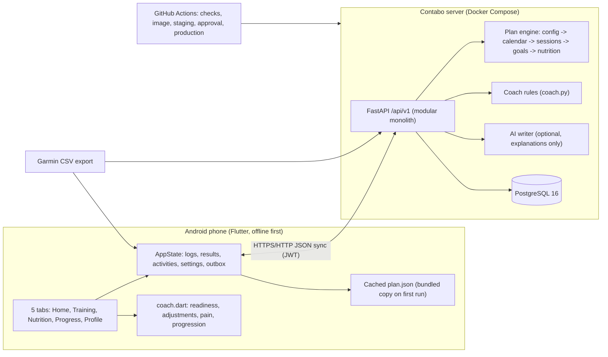

# Architecture

## Modules (server/app)
| Module | File | Responsibility |
|---|---|---|
| Authentication | `security.py`, routes in `main.py` | PBKDF2 password hashing (240k iterations), signed JWT, first-account-only registration by default |
| Athlete profiles and fasting | `engine/config.py`, `/config` | The athlete config and its validation; defaults merged under the user's settings |
| Race management | `/races` | Add, edit, remove; every change rebuilds and versions the plan |
| Training plans, workouts, running, swimming, cycling, strength, HYROX | `engine/sessions.py`, `engine/hyrox.py` | Date-driven calendar and every session's rows |
| Exercise library, mobility, pelvic floor | `engine/library.py` | Library with equipment, difficulty, regressions and progressions |
| Nutrition and supplements | `engine/nutrition.py`, `engine/build.py` | Foods, prices, meal plans, shopping list, supplements, sports nutrition |
| Goals | `engine/goals.py`, `logic.py` | SMART goals from races; status calculations (mirrored in `logic.dart`) |
| Sleep, recovery and the daily coach | `engine/coach.py` | Readiness, adjustments, pain, progression, load warning, streak |
| AI coaching | `ai.py` | Provider-independent writer. Off unless `AI_BASE_URL`, `AI_API_KEY`, `AI_MODEL` are set |
| Integrations | `engine/garmin.py`, `/activities` | Garmin CSV adapter; other adapters plug in by producing the same activity records |
| Analytics | `logic.py`, app `progress_screen.dart` | Weekly review, trends |
| Persistence | `db.py` | SQLAlchemy models, ordered migrations |

## Key decisions
1. **Keep Flutter + FastAPI instead of React Native + NestJS.** The athlete already runs this stack with working CI/CD on his server. A rewrite would cost weeks and add risk without adding features he needs. Every brief capability maps onto this stack; the module boundaries above allow extraction later.
2. **Plan engine on the server, plan cached on the phone.** The engine is pure Python with no dependencies, so it is easy to test. The phone never needs the engine: it downloads the plan when the version changes (ETag) and works offline from the cached copy. Settings changed offline are queued and applied at the next sync.
3. **Deterministic safety rules.** Readiness, adjustments, pain handling and progression are rules, tested on both server and phone. AI output is limited to wording and cannot change numbers.
4. **Document-style day logs.** One JSON document per user per day (sessions done, sets with exercise names, feedback, readiness, food, supplements), validated field by field. The planned session names are snapshotted into each log and every replaced copy is kept in `day_log_versions`, so changing the plan never rewrites history.
5. **No Redis or S3 yet.** There is one user and the plan builds in about 0.1 s and is cached in memory, so neither is needed. Both are documented extension points: Redis for background import jobs, S3-compatible storage for exercise media.
6. **Environments**: development (`docker compose up` at the repo root), staging (`~/salum-tracker-staging`, port 8091, separate database) and production (`~/salum-tracker`, port 8090), with an approval gate before production.

## Offline sync and conflicts
- The phone writes locally first and adds the change to an outbox. Sync sends the outbox, then pulls everything the server changed since the last sync.
- Conflicts resolve last-write-wins per day, per result and per config, using the time of the edit on the device. The losing copy is preserved in `day_log_versions`.
- The sync icon shows the status: synced, waiting to upload, or offline.

## Security
- Secrets exist only as GitHub secrets and in the server's `.env` (mode 600). Nothing is committed.
- Least-privilege workflow permissions; CodeQL; gitleaks secret scan; pip-audit; Dependabot.
- CSV export escapes spreadsheet formulas.
- Recommended: put the API behind HTTPS (Caddy or nginx with Let's Encrypt) and then turn off cleartext in `android_patch.py`.
