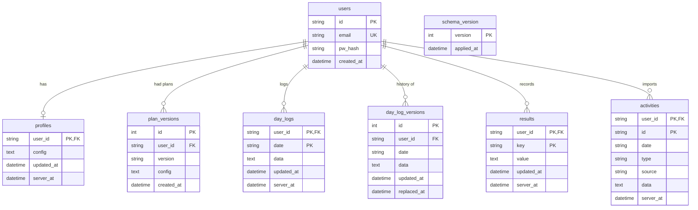

# Database

## How the brief's entities map
| Brief entity | Where it lives |
|---|---|
| User | `users` |
| AthleteProfile, FastingSchedule | `profiles.config` (profile, fasting, Ramadan, preferences, equipment, baseline) |
| RaceEvent | `profiles.config.races` |
| TrainingPlan, TrainingPhase, TrainingWeek, ScheduledWorkout, Workout, WorkoutExercise, Exercise | Generated by the engine from the config (`plan.phases`, `plan.weeks`, `plan.days`, `plan.sessions[].rows`, `plan.library`); every version is recorded in `plan_versions` |
| WorkoutSession, ExerciseSet, WorkoutMetric (completed workout and actual performance) | `day_logs.data`: `am_done`, `done[]`, `sets{row: [{kg, reps, rpe, ex}]}`, `am_fb`/`pm_fb` {done, rpe, pain, pain_area, energy, minutes, notes}, `run_km`, `swim_m`, `swim_cont_m`, `swolf`, `bike_km` and more |
| Planned workout (as it was) | `day_logs.data.planned` snapshot plus `day_log_versions` |
| RunningActivity, SwimmingActivity, CyclingActivity | `activities` (Garmin CSV now; other adapters later) |
| NutritionPlan, Meal, FoodItem | `plan.nutrition` (meal plans, foods with prices) |
| FoodLog | `day_logs.data`: `meals_eaten[]`, `kcal`, `protein`, `carbs`, `fat`, `water` |
| Supplement, SupplementLog | `plan.supplements`; `day_logs.data.supps_taken[]` |
| SleepRecord, RecoveryRecord | `day_logs.data`: `sleep_h`, `sleep_q`, `soreness`, `energy`, `stress`, `rhr`, `hrv`, `pain_today`, `pain_areas[]` |
| ProgressMetric | `results` (`base:*` baselines, `goal:*`, `mini:*`) |
| AI recommendation | Computed on request (`/coach/today`, `/coach/explain`); never stored as an instruction |

## Constraints and indexes
- Composite primary keys (user, date), (user, key) and (user, activity id) make every write an upsert and prevent duplicates.
- `server_at` is indexed on every synced table for fast "changed since" queries.
- Cascading deletes from `users`.
- Every field of a day log is validated by the API (type and range); unknown fields are rejected.

## Migrations
`db.py` holds ordered, idempotent migrations recorded in `schema_version`. Add new ones at the end and never edit an applied one. Version 2 creates the EnduraForge tables and widens `results.key`.
